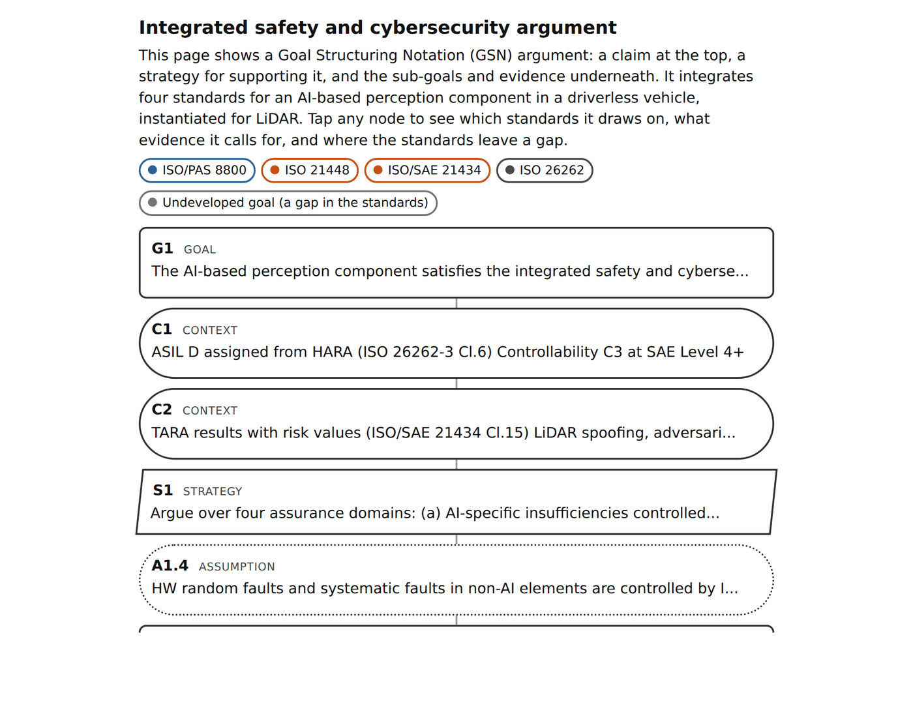
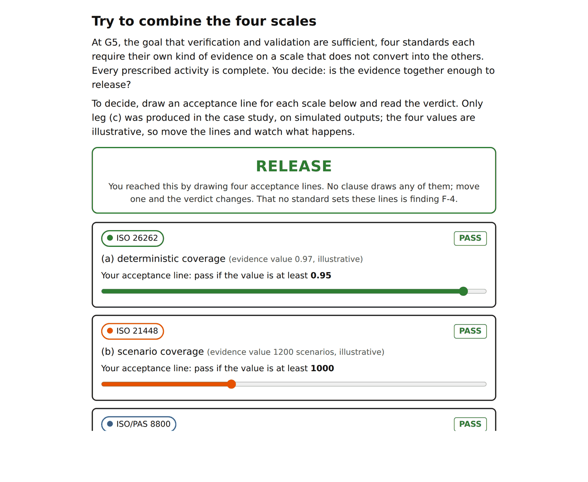

# Assurance Gaps in an Integrated Safety and Cybersecurity Case

Milin Patel and Rolf Jung, Kempten University of Applied Sciences.
Supplementary material for two SAFECOMP 2026 papers, both accepted.

[](https://github.com/milinpatel07/Assurance-Gaps-in-an-Integrated-Safety-and-Cybersecurity-Case/actions/workflows/ci.yml)
[](https://doi.org/10.5281/zenodo.22091825)
[](LICENSE)
[](pyproject.toml)

An AI perception component in a driverless vehicle has to satisfy four
standards at once, and each one prescribes its own evidence. This repository
builds the one assurance argument the four jointly imply, written in Goal
Structuring Notation (GSN), and reports what the combination exposes: places
where an engineer can do everything each standard asks and still be unable to
say whether the evidence, taken together, is enough.

**Start here:**
[the argument, one node at a time](https://milinpatel07.github.io/Assurance-Gaps-in-an-Integrated-Safety-and-Cybersecurity-Case/gsn_view.html) ·
[where the numbers come from](https://milinpatel07.github.io/Assurance-Gaps-in-an-Integrated-Safety-and-Cybersecurity-Case/numbers.html) ·
[what it found](#what-it-found) ·
[reproduce it](#reproduce-it)

[](https://milinpatel07.github.io/Assurance-Gaps-in-an-Integrated-Safety-and-Cybersecurity-Case/gsn_view.html)

The image is a still. [Open the live page](https://milinpatel07.github.io/Assurance-Gaps-in-an-Integrated-Safety-and-Cybersecurity-Case/gsn_view.html)
to tap each node. It works on a phone.

## The problem

Four standards apply to the component, each from its own angle:

| Standard | Concern | The evidence it asks for at verification |
|---|---|---|
| ISO 26262 | Functional safety: faults in hardware and software | Structural coverage (MC/DC) of the non-AI code |
| ISO 21448 | SOTIF: hazards that arise while the function works as designed | Scenario coverage against triggering conditions such as rain and fog |
| ISO/PAS 8800 | Safety of AI | A statistical uncertainty score, here ensemble disagreement (AUROC) |
| ISO/SAE 21434 | Cybersecurity | Results of penetration testing, such as an attack success rate |

Each standard is complete on its own terms. None of them says how its claims
sit beside the others under one top claim, and the GSN pattern ISO/PAS 8800
publishes for AI components (Annex B) leaves cybersecurity out. The question
both papers ask is what becomes visible once the four are placed in a single
argument. The papers choose that structure and give their reasons; no
standard prescribes it.

The case study is a LiDAR 3D object detector for cars, pedestrians and
cyclists in a vehicle with no driver to fall back on.

## How the argument is built

The WAISE paper's method has five steps. Steps 1 to 3 build the argument;
steps 4 and 5 examine it. Every count in the papers is the output of one step,
not a target set in advance.

| Step | What it does | What it produces |
|---|---|---|
| 1. Claim extraction | Reads each standard at clause level; every claim names its clause | 40 claims from the four standards and one informative report |
| 2. Lifecycle mapping | Places each claim on one of six lifecycle phases | A coverage grid: where standards overlap, where none speaks |
| 3. GSN construction | Keeps the Annex B goals, attaches claims where they fit, adds a goal only where nothing fits | The nine-goal pattern: 6 kept, 2 added (G7, G8), 1 left undeveloped (G9) |
| 4. Junction analysis | Examines every goal where two or more standards meet | Seven decision points: 3 structural, 2 terminological, 2 methodological |
| 5. Finding classification | Separates what only the combination reveals from open method problems | Five findings: 2 integration-induced, 3 open methodological problems |

**Why these numbers and not others?**
[Where the numbers come from](https://milinpatel07.github.io/Assurance-Gaps-in-an-Integrated-Safety-and-Cybersecurity-Case/numbers.html)
takes each count in turn: the rule that produced it, what it breaks down into,
and whether it reflects a choice or a result. In short, the scope (four
standards) and the base pattern (Annex B) are choices; the seven and the five
are what the examination found. The two integration-induced findings were also
derived under a second argument structure, the concern hierarchy of Warg and
Skoglund, and they arise under both
([`topology_sensitivity.py`](src/analysis/topology_sensitivity.py)).

## What it found

### Before release: four kinds of evidence, no rule to combine them

One goal carries all four standards at once: G5, the claim that verification
and validation are sufficient. The four kinds of evidence there measure on
scales that do not convert into one another, and no standard says how to
combine them into one judgement. An engineer can complete every prescribed
activity and still be unable to state whether the evidence together is enough.

[](https://milinpatel07.github.io/Assurance-Gaps-in-an-Integrated-Safety-and-Cybersecurity-Case/g5_playground.html)

[Drag the four scales](https://milinpatel07.github.io/Assurance-Gaps-in-an-Integrated-Safety-and-Cybersecurity-Case/g5_playground.html)
and the verdict flips; no clause draws any of the four lines. The whole
argument, all nine goals with the evidence under each, is one diagram:
[integrated_gsn.png](docs/figures/integrated_gsn.png).

Two findings appear only when the standards are combined, never when each is
read alone:

- **F-3, the adversarial-SOTIF boundary.** Heavy rain and a LiDAR spoofing
  attack can thin the point cloud in the same way. ISO 21448 excludes attacks,
  and ISO/SAE 21434 does not refer to ISO 21448, so neither standard owns a
  failure that is both a triggering condition and a threat.
- **F-4, the release decision.** Each standard produces its own assessment. A
  component can satisfy all four, and still no standard requires judging the
  combined residual risk across them.

The other three findings (F-1, F-2, F-5) are open methodological problems: the
standards prescribe a framework, and no published method yet supplies the
values an AI component needs.

### In service: an alarm that belongs to no one

The position paper moves to operation. A runtime monitor raises an alarm that
carries no label, because rain and an attack can produce the same missing
detections. ISO 21448, ISO/PAS 8800 and ISO/SAE 21434 each define an activity
for the operation phase, each within its own concern. No clause assigns the
alarm to one of them (the assignment step), and none says how their results
resolve into one judgement on the argument (the resolution step). The paper argues this from clause text, not
from code.

**Follow one anomaly yourself.** `notebooks/anomaly_walk.ipynb` takes a single
runtime alarm and asks each standard, clause by clause, whether it owns it.
The walk ends without an answer. It demonstrates the position paper's argument
rather than evidencing it.

### One problem at two lifecycle points

Each paper reports the same junction: evidence on scales that do not convert
into one another, and no clause saying how to combine it.
[The seam page](https://milinpatel07.github.io/Assurance-Gaps-in-an-Integrated-Safety-and-Cybersecurity-Case/seam.html)
sets the two side by side. That connection is a synthesis drawn here, not a
claim either paper makes.

## The two papers

| Paper | Question | Backed by code? |
|---|---|---|
| [`paper/waise2026/`](paper/waise2026/) | What does combining the four standards expose at design time? | Yes, `src/` |
| [`paper/safecomp2026-position/`](paper/safecomp2026-position/) | An alarm fires in service. Which concern owns it? | No. A notebook demonstrates the argument; no code evidences it |

The WAISE paper builds the nine-goal pattern by extending ISO/PAS 8800 Annex B
from six goals to nine, catalogues seven decision points where the standards
hand a choice to the project, and classifies five findings. The `src/` code
produces all three, and the test suite checks them against the paper.

The position paper states the operational gap and four requirements (R1 to
R4) that any method closing it must meet.

## Terms used here

| Term | Meaning in this work |
|---|---|
| GSN | Goal Structuring Notation: a top claim broken into sub-claims (goals), linked by strategies and supported by evidence (solutions) |
| Annex B | The GSN pattern ISO/PAS 8800 publishes for an AI component; the base this argument extends |
| SOTIF | Safety of the intended functionality (ISO 21448): hazards from performance limits, not from faults |
| Triggering condition | A specific condition of a scenario, such as heavy rain, that sets off a system reaction which can lead to hazardous behaviour |
| TARA | Threat analysis and risk assessment (ISO/SAE 21434) |
| ASIL | Automotive safety integrity level (ISO 26262), from A to D; the case study is ASIL D |
| V&V | Verification and validation; goal G5 |
| Decision point (DP) | A place where the standards leave a choice to the project instead of prescribing one |
| Structural / terminological / methodological | A decision no standard prescribes / two terms for one concept / two methods for one aim |
| Integration-induced finding | A finding that exists only between the scopes of the standards, invisible from any one of them |
| Open methodological problem | A framework the standards prescribe, with no published method for the values it needs |
| Concern | One assurance dimension owned by one standard: SOTIF, AI safety, or cybersecurity |
| Assignment and resolution | The two steps the position paper finds missing: giving an unlabelled alarm to a concern, and combining the concerns' results into one judgement |

The papers write DP-2 and F-3 where the code writes `I-2` and `Gap-3`;
[TRACEABILITY.md](TRACEABILITY.md) carries the full crosswalk.

## Explore it

| What | Where |
|---|---|
| The argument, node by node | [gsn_view.html](https://milinpatel07.github.io/Assurance-Gaps-in-an-Integrated-Safety-and-Cybersecurity-Case/gsn_view.html) |
| Where the numbers come from | [numbers.html](https://milinpatel07.github.io/Assurance-Gaps-in-an-Integrated-Safety-and-Cybersecurity-Case/numbers.html) |
| The G5 playground | [g5_playground.html](https://milinpatel07.github.io/Assurance-Gaps-in-an-Integrated-Safety-and-Cybersecurity-Case/g5_playground.html) |
| The seam between the papers | [seam.html](https://milinpatel07.github.io/Assurance-Gaps-in-an-Integrated-Safety-and-Cybersecurity-Case/seam.html) |
| Follow one runtime anomaly | [](https://colab.research.google.com/github/milinpatel07/Assurance-Gaps-in-an-Integrated-Safety-and-Cybersecurity-Case/blob/main/notebooks/anomaly_walk.ipynb) `notebooks/anomaly_walk.ipynb` |
| Set your own acceptance lines at G5 | [](https://colab.research.google.com/github/milinpatel07/Assurance-Gaps-in-an-Integrated-Safety-and-Cybersecurity-Case/blob/main/notebooks/g5_evidence_walk.ipynb) `notebooks/g5_evidence_walk.ipynb` |
| The five-step method, end to end | [](https://colab.research.google.com/github/milinpatel07/Assurance-Gaps-in-an-Integrated-Safety-and-Cybersecurity-Case/blob/main/notebooks/assurance_gaps_analysis.ipynb) `notebooks/assurance_gaps_analysis.ipynb` |

## Reproduce it

```bash
pip install -r requirements.lock && pip install -e . --no-deps
make reproduce
```

`make reproduce` regenerates every artefact both papers use, then diffs the
result against the copies committed here. It prints a diff and fails if
anything drifted. The lockfile needs Python 3.12 or newer (it was frozen on
3.13, the version CI runs); [REPRODUCING.md](REPRODUCING.md) covers the
details, including the path for Python 3.9 to 3.11, the Windows path-length
trap, and what the lockfile pins. PyTorch is not required.

## What each file is, and how far to trust it

Every artefact declares its provenance, because the kinds are not
interchangeable:

| Kind | Where | What it means |
|---|---|---|
| Argued | `src/`, `gsn/` | The method and the argument, as described in the WAISE paper |
| Generated | `TRACEABILITY.md`, `docs/*.html` | Committed, and rebuilt by a command. A test fails if the committed copy is stale |
| Generated, not committed | `output/` | `make reproduce` builds it, then diffs it against the seeded references |
| Seeded | `data/synthetic_illustrations/` | Deterministic output at seed 42. Illustrations of the pipeline, not measurements |
| Measured | `data/empirical_results/` | Real measurements from trained models. They support a paper in preparation, and neither paper here claims them |

[TRACEABILITY.md](TRACEABILITY.md) is the index: every number, table and
figure traces to a passage in a paper, a clause in a named standard edition,
or a command that regenerates it. The clause-to-node rows are also exported
for loading as [`docs/traceability.json`](docs/traceability.json) and
[`docs/traceability.csv`](docs/traceability.csv).

[ERRATA.md](ERRATA.md) records what this work found about the camera-ready
papers, including places where the papers' own tables and prose disagree.

## Map

```
paper/waise2026/            Camera-ready source of the GSN pattern paper
paper/safecomp2026-position/  Camera-ready source of the position paper
src/                        The five-step method: claims, GSN, decision points, findings
gsn/                        The argument in YAML, rendered by gsn2x
tests/                      471 tests, including the paper's own claims
data/                       Seeded illustrations and measured results, each with a README
docs/                       The website: argument view, numbers, playground, seam, figures
notebooks/                  The anomaly walk, the G5 walk, and the method end to end
Makefile                    reproduce, test, results, gsn, traceability, pages
```

## Citation

Cite the papers, not this repository:

```bibtex
@inproceedings{PatelJungWAISE2026,
  author    = {Patel, Milin and Jung, Rolf},
  title     = {Integrating Cybersecurity into the {AI} Safety Assurance Argument:
               A {GSN} Pattern for {AI}-Based Perception Components in
               Highly Automated Driving},
  booktitle = {WAISE 2026 Workshop at SAFECOMP 2026},
  series    = {LNCS},
  publisher = {Springer},
  year      = {2026}
}

@inproceedings{PatelJungPosition2026,
  author    = {Patel, Milin and Jung, Rolf},
  title     = {Operational Safety and Cybersecurity Assurance of {AI}-Based
               Perception in Highly Automated Driving},
  booktitle = {SAFECOMP 2026},
  year      = {2026}
}
```

[CITATION.cff](CITATION.cff) carries the same details in machine-readable form.

## The website the QR code opens

The poster's QR code resolves to
<https://milinpatel07.github.io/Assurance-Gaps-in-an-Integrated-Safety-and-Cybersecurity-Case/>,
which GitHub Pages serves from [`docs/`](docs/). It opens on four panels (the
interactive argument, the seam between the two papers, the traceability index,
and the papers themselves) and links onward to the numbers page and the G5
playground.

## Archive

Release `v1.0.0` is the camera-ready snapshot, archived on Zenodo.

| DOI | Resolves to |
|---|---|
| [10.5281/zenodo.22091825](https://doi.org/10.5281/zenodo.22091825) | The repository, always the latest version. Cite this one unless you need a specific release |
| [10.5281/zenodo.22091826](https://doi.org/10.5281/zenodo.22091826) | Release `v1.0.0` specifically |

The archived snapshot is the tagged commit, so it predates any change made after
the tag. `.zenodo.json` holds the archive metadata.

## License

MIT.
