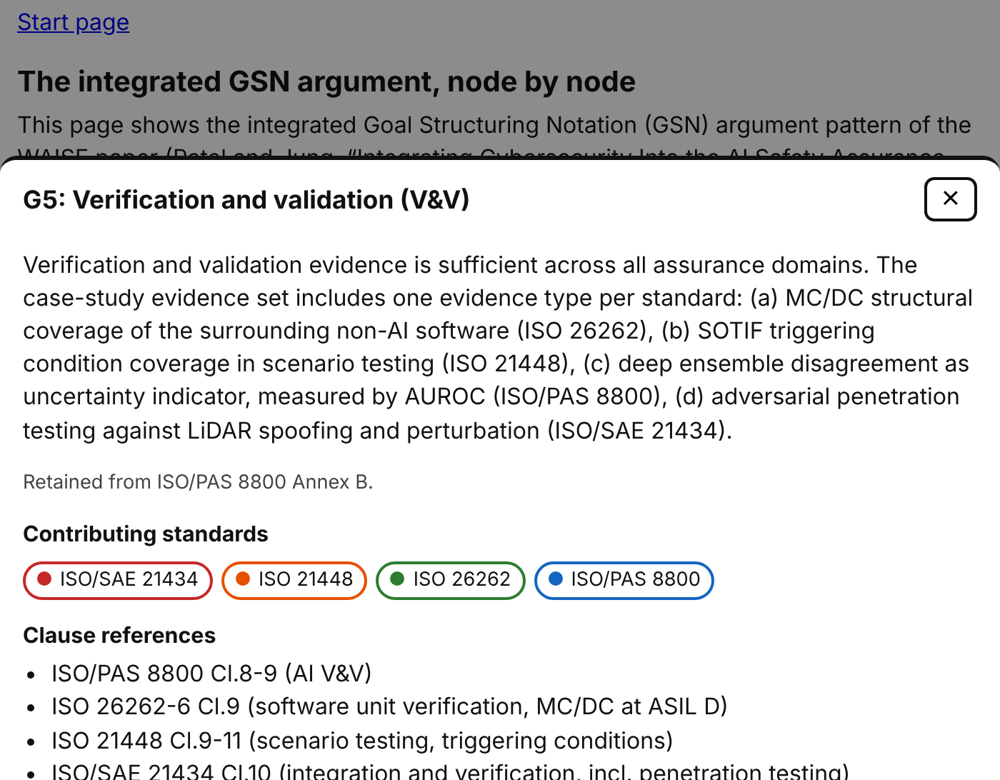
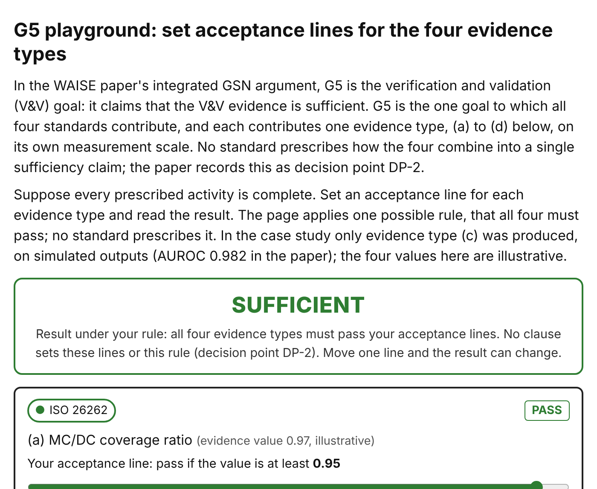

# Assurance Gaps in an Integrated Safety and Cybersecurity Case

Milin Patel and Rolf Jung, Kempten University of Applied Sciences.
Supplementary material for a WAISE 2026 workshop paper and a SAFECOMP 2026
position paper.

[](https://github.com/milinpatel07/Assurance-Gaps-in-an-Integrated-Safety-and-Cybersecurity-Case/actions/workflows/ci.yml)
[](https://doi.org/10.5281/zenodo.22091825)
[](LICENSE)
[](pyproject.toml)

An AI-based perception component for highly automated driving falls within the
scope of four standards at once, and each prescribes its own assurance
activities and evidence. The WAISE paper combines their claims in one
integrated argument in Goal Structuring Notation (GSN), a structure that no
standard prescribes, and examines where the standards leave decisions to the
project. Its central result: at the verification and validation goal, the four
standards call for four evidence types on different measurement scales, and no
standard prescribes how they combine into one judgement that the evidence is
sufficient. The position paper finds a corresponding gap in operation.

**Start here:** [the website](https://milinpatel07.github.io/Assurance-Gaps-in-an-Integrated-Safety-and-Cybersecurity-Case/) ·
[the integrated GSN argument, node by node](https://milinpatel07.github.io/Assurance-Gaps-in-an-Integrated-Safety-and-Cybersecurity-Case/argument.html) ·
[where the numbers come from](https://milinpatel07.github.io/Assurance-Gaps-in-an-Integrated-Safety-and-Cybersecurity-Case/numbers.html)

[](https://milinpatel07.github.io/Assurance-Gaps-in-an-Integrated-Safety-and-Cybersecurity-Case/argument.html)

## The two papers

| Short name | Paper | Lifecycle phase | Backed by code here? |
|---|---|---|---|
| WAISE paper | *Integrating Cybersecurity Into the AI Safety Assurance Argument: A GSN Pattern for AI-Based Perception Components in Highly Automated Driving.* SAFECOMP 2026 Workshops (WAISE), LNCS, Springer, pp. 763-779. [doi:10.1007/978-3-032-35506-5_55](https://doi.org/10.1007/978-3-032-35506-5_55) | Design time | Yes: `src/` produces the argument, the decision points and the findings, and the tests check them against the paper |
| Position paper | *Operational Safety and Cybersecurity Assurance of AI-Based Perception in Highly Automated Driving.* SAFECOMP 2026, to appear | Operation | No: it argues from clause text. A notebook demonstrates the argument |

The repository title uses "gaps" for both papers' results: the WAISE paper's
decision points and findings, and the position paper's two missing steps. The
integrated argument is a GSN pattern for the AI component, placed inside the
encompassing system safety case; it does not merge the ISO 26262 safety case
with the ISO/SAE 21434 cybersecurity case.

## Key terms

| Term | Meaning in this work |
|---|---|
| GSN | Goal Structuring Notation: a top claim (goal) broken into sub-goals by strategies, each supported by evidence (solutions) |
| Annex B | The GSN pattern for an AI component in ISO/PAS 8800 (informative). The WAISE paper extends it |
| Assurance domain, concern | The scope of one standard: functional safety, SOTIF, AI safety or cybersecurity. The WAISE paper says "assurance domain"; the position paper says "concern" |
| SOTIF | Safety of the intended functionality (ISO 21448): hazards from functional insufficiencies, that is, insufficiencies of the specification or performance insufficiencies, or from reasonably foreseeable misuse, without a fault |
| Triggering condition | After ISO 21448: a specific condition of a scenario, such as heavy rain, that initiates a system reaction which can lead to hazardous behaviour |
| TARA | Threat analysis and risk assessment (ISO/SAE 21434) |
| ASIL | Automotive safety integrity level (ISO 26262), A to D; the case study is ASIL D |
| G1 to G9 | The goals of the integrated argument. G5 is the verification and validation (V&V) goal |
| Junction | A goal where claims from two or more standards meet |
| Decision point (DP) | A place where the standards defer to application context, so the engineer must decide. Types: terminological (different terms for the same concept), methodological (different methods for the same objective), structural (frameworks requiring decisions that no standard prescribes) |
| Finding (F) | What the integrated argument exposes, in two categories. An integration-induced finding emerges only between the scopes of the standards and cannot be detected from any one of them alone. For an open methodological problem, the standards prescribe a framework, but no published method specifies the application-specific values or workflow an AI component needs |
| Runtime anomaly | An abnormal output of a runtime monitor in operation; it carries no concern label |
| Assignment, resolution | The position paper's two missing steps: assigning a runtime anomaly to a concern, and resolving the concern-specific results into one judgement on the assurance argument |

The papers write DP-2 and F-3 where the code writes `I-2` and `Gap-3`;
[TRACEABILITY.md](TRACEABILITY.md) has the full crosswalk.

## The problem

The WAISE paper gives one reason why each standard applies to the component,
and names the evidence type each contributes to G5 in the case study:

| Standard | Why it applies to the component | Evidence type at G5 in the case study |
|---|---|---|
| ISO 26262 (functional safety) | A perception failure can contribute to ASIL D hazardous events at SAE Level 4 | (a) MC/DC structural coverage of the surrounding non-AI software |
| ISO 21448 (SOTIF) | The intended function can produce hazardous behaviour without a fault | (b) Triggering-condition coverage in scenario testing under rain and fog |
| ISO/PAS 8800 (AI safety) | The component is a trained neural network | (c) Deep-ensemble disagreement as uncertainty indicator, measured by AUROC |
| ISO/SAE 21434 (cybersecurity) | The sensor data are vulnerable to adversarial manipulation | (d) Adversarial penetration testing, measured as attack success rate |

The standards cross-reference each other at the level of requirements,
activities and evidence. None prescribes how their claims combine under one
top-level goal, and the Annex B pattern of ISO/PAS 8800 has no goal for ISO
21448 or ISO/SAE 21434 claims. ISO/IEC TR 5469 is also cited, as an informative
technical report. The case study is a LiDAR-based 3D object detection component
(the SECOND architecture with a deep ensemble).

## How the WAISE paper builds the argument

The method has five steps. Steps 1 to 3 build the argument; steps 4 and 5
examine it. Each count below is explained, with its reason and whether it is a
scope choice or a result, on
[where the numbers come from](https://milinpatel07.github.io/Assurance-Gaps-in-an-Integrated-Safety-and-Cybersecurity-Case/numbers.html).

| Step | What it does | What it produces |
|---|---|---|
| 1. Claim extraction | Reads each standard at clause level; each claim names its clause | 40 claims in this repository's encoding (the papers report no count) |
| 2. Lifecycle-phase mapping | Places each claim on one of six phases, from concept and requirements to modification and re-assurance | A grid of where the standards overlap and where none applies |
| 3. GSN construction | Starts from Annex B, attaches claims to existing goals where the assurance domain matches, adds a goal only where no equivalent exists | The nine-goal pattern: G1 reformulated, 5 retained (G2 to G6), 2 added (G7, G8), 1 added and undeveloped (G9) |
| 4. Junction-point analysis | Examines each goal where claims from two or more standards meet | Seven decision points: 3 structural, 2 terminological, 2 methodological |
| 5. Finding identification | Separates what only the combination exposes from open methodological problems | Five findings: 2 integration-induced, 3 open methodological problems |

## What the WAISE paper finds (design time)

### At G5: four evidence types and no prescribed way to combine them

G5 claims that the V&V evidence is sufficient across all assurance domains. It
is the goal to which all four standards contribute, so it receives four
evidence types, one from each (table above). The types are disjoint by design,
each on its own measurement scale, and no standard prescribes how they combine
into a single sufficiency claim at G5. This is decision point DP-2. An engineer
who has completed every prescribed verification activity still cannot state,
from the standards alone, whether the evidence together is sufficient. The
paper assigns the choice to a project-level evidence admissibility policy with
documented rationale.

[](https://milinpatel07.github.io/Assurance-Gaps-in-an-Integrated-Safety-and-Cybersecurity-Case/g5-playground.html)

The [G5 playground](https://milinpatel07.github.io/Assurance-Gaps-in-an-Integrated-Safety-and-Cybersecurity-Case/g5-playground.html)
lets you set an acceptance line for each evidence type and see the result
change; no clause sets any of the lines.

### Decision points (WAISE Table 4)

| ID | Decision point | Type | Goal |
|---|---|---|---|
| DP-1 | Risk classification across three frameworks | Structural | G1 |
| DP-2 | Evidence type asymmetry at V&V | Structural (see [ERRATA.md](ERRATA.md), entry 1) | G5 |
| DP-3 | AI error terminology differs | Terminological | G2, G7 |
| DP-4 | "Validation" defined differently | Terminological | G5 |
| DP-5 | Cybersecurity-SOTIF boundary not bridged at standards level | Structural | G7, G8 |
| DP-6 | Monitoring scope overlap | Methodological | G6 |
| DP-7 | Data sufficiency deferred to context | Methodological | G3 |

A project can settle the terminological and methodological decision points by
agreeing on a vocabulary or a method. The structural ones need a decision that
no standard prescribes.

### Findings (WAISE Table 5)

| ID | Finding | Category |
|---|---|---|
| F-3 | Adversarial-SOTIF boundary unowned: an adversarial input that exploits a functional insufficiency is both a threat scenario and a triggering condition, and belongs to neither G7 nor G8 | Integration-induced |
| F-4 | No cross-domain release criteria: a component can satisfy each standard, yet no standard requires evaluating the combined residual risk across domains | Integration-induced |
| F-1 | Quantitative acceptance criteria for AI components: the framework exists (ISO 21448 Cl.6.5), the values are deferred to context | Open methodological problem |
| F-2 | Over-the-air re-assurance workflow: only partial coverage, so G9 is undeveloped | Open methodological problem |
| F-5 | Data acceptance criteria for AI components: frameworks exist, thresholds are deferred to context | Open methodological problem |

## What the position paper argues (operation)

In operation, a runtime monitor can report an abnormal output, for example a
scene region where detections drop. The anomaly carries no concern label: rain
and a LiDAR spoofing attack can produce the same missing detections. Three
standards define an operation-phase activity that uses such evidence: ISO 21448,
ISO/PAS 8800 and ISO/SAE 21434. (Random hardware faults lie outside the
ambiguity, because ISO 26262 requires diagnostic mechanisms that label such a
fault when it is detected.) No
clause in these standards assigns the anomaly to a concern, and none resolves
the concern-specific results into one judgement on the assurance argument.

The paper's position is that closing this gap is an in-service re-evaluation of
the safety case at the assurance argument, not an in-vehicle runtime function.
It states four requirements for a method that closes it, each necessary,
without claiming the set is sufficient: R1, accept evidence on different
measurement scales at one claim; R2, an assignment step, with the unassignable
case as a defined outcome; R3, a judgement traceable to the operation-phase
activities, current, and reportable; R4, which evidence remains valid after a
component update.

The [anomaly notebook](notebooks/3_runtime_anomaly.ipynb) follows one runtime
anomaly through the clauses of each standard and shows that none assigns it.

## Design time and operation side by side

At G5 in the WAISE paper and in the re-evaluation after a runtime anomaly in the
position paper, results on different measurement scales have to support one
claim, and no clause says how to combine them. The
[comparison page](https://milinpatel07.github.io/Assurance-Gaps-in-an-Integrated-Safety-and-Cybersecurity-Case/design-time-and-operation.html)
sets the two side by side and lists what differs. The comparison is a synthesis
drawn in this repository; neither paper states it.

## Explore it

| What | Where |
|---|---|
| The integrated GSN argument, node by node: the standards, evidence, decision points and findings at each goal | [argument.html](https://milinpatel07.github.io/Assurance-Gaps-in-an-Integrated-Safety-and-Cybersecurity-Case/argument.html) |
| Where the numbers come from: the reason for each count | [numbers.html](https://milinpatel07.github.io/Assurance-Gaps-in-an-Integrated-Safety-and-Cybersecurity-Case/numbers.html) |
| G5 playground: set acceptance lines for the four evidence types | [g5-playground.html](https://milinpatel07.github.io/Assurance-Gaps-in-an-Integrated-Safety-and-Cybersecurity-Case/g5-playground.html) |
| Design time and operation: the two papers side by side | [design-time-and-operation.html](https://milinpatel07.github.io/Assurance-Gaps-in-an-Integrated-Safety-and-Cybersecurity-Case/design-time-and-operation.html) |
| Anomaly notebook: which concern a runtime anomaly is assigned to | [](https://colab.research.google.com/github/milinpatel07/Assurance-Gaps-in-an-Integrated-Safety-and-Cybersecurity-Case/blob/main/notebooks/3_runtime_anomaly.ipynb) `notebooks/3_runtime_anomaly.ipynb` |
| G5 notebook: two rules for combining the four evidence types, in Python | [](https://colab.research.google.com/github/milinpatel07/Assurance-Gaps-in-an-Integrated-Safety-and-Cybersecurity-Case/blob/main/notebooks/2_g5_evidence_types.ipynb) `notebooks/2_g5_evidence_types.ipynb` |
| Method notebook: the five steps, run end to end, with repository analyses marked as such | [](https://colab.research.google.com/github/milinpatel07/Assurance-Gaps-in-an-Integrated-Safety-and-Cybersecurity-Case/blob/main/notebooks/1_five_step_method.ipynb) `notebooks/1_five_step_method.ipynb` |
| The whole argument as one diagram | [integrated_gsn.png](docs/figures/integrated_gsn.png) |

The website is what the poster's QR code opens. GitHub Pages serves it from
[`docs/`](docs/).

## Reproduce it

```bash
pip install -r requirements.lock && pip install -e . --no-deps
make reproduce
```

`make reproduce` regenerates every artefact and fails with a diff if anything
differs from the committed copies. It needs Python 3.12 or newer;
[REPRODUCING.md](REPRODUCING.md) covers older Python versions and the details.

## Provenance and errata

Each artefact has one of five kinds of provenance, and they are not
interchangeable:

| Kind | Where | Meaning |
|---|---|---|
| Argued | `src/` | The method and the argument, as the WAISE paper describes them |
| Hand-written | `gsn/*.gsn.yaml`, `data/case_study_parameters/`, `data/standards_reference/` | Written by hand; no command regenerates them |
| Generated | `TRACEABILITY.md`, `docs/*.html`, `docs/figures/`, two of the notebooks | Written by a command from the code; a test or `make verify-refs` fails if a committed copy is out of date |
| Seeded | `data/synthetic_illustrations/` | Generated from a fixed seed (42); illustrations of the pipeline, not measurements |
| Measured | `data/empirical_results/` | Measurements from trained models for a paper in preparation; neither paper here relies on them ([details](data/empirical_results/README.md)) |

[TRACEABILITY.md](TRACEABILITY.md) traces every number, table and figure to a
passage in a paper, a clause in a named standard edition, or a command, and
exports the clause-to-goal rows as [`docs/traceability.json`](docs/traceability.json)
and [`docs/traceability.csv`](docs/traceability.csv).
[ERRATA.md](ERRATA.md) lists the known discrepancies between the camera-ready
papers and this repository.

## Repository layout

```
src/                          The five-step method: claims, GSN, decision points, findings
gsn/                          The argument in YAML, rendered by gsn2x
tests/                        499 tests, including the paper's own claims
data/                         Seeded illustrations, measured results, case-study parameters and standards notes, each with a README
docs/                         The website, figures and traceability exports
notebooks/                    Anomaly notebook, G5 notebook, method notebook
Makefile                      reproduce, test, results, gsn, traceability, pages
```

## Citation and archive

To cite the research, cite the papers:

```bibtex
@inproceedings{PatelJungWAISE2026,
  author    = {Patel, Milin and Jung, Rolf},
  title     = {Integrating Cybersecurity Into the {AI} Safety Assurance Argument:
               A {GSN} Pattern for {AI}-Based Perception Components in
               Highly Automated Driving},
  booktitle = {Computer Safety, Reliability, and Security. SAFECOMP 2026
               Workshops},
  series    = {Lecture Notes in Computer Science},
  publisher = {Springer},
  address   = {Cham},
  pages     = {763--779},
  year      = {2026},
  doi       = {10.1007/978-3-032-35506-5_55}
}

@inproceedings{PatelJungPosition2026,
  author    = {Patel, Milin and Jung, Rolf},
  title     = {Operational Safety and Cybersecurity Assurance of {AI}-Based
               Perception in Highly Automated Driving},
  booktitle = {SAFECOMP 2026},
  year      = {2026},
  note      = {To appear}
}
```

To cite this repository itself (code and data), use its Zenodo DOI.
[CITATION.cff](CITATION.cff) carries the same details in machine-readable form.

| DOI | Resolves to |
|---|---|
| [10.5281/zenodo.22091825](https://doi.org/10.5281/zenodo.22091825) | The repository, latest archived version |
| [10.5281/zenodo.22091826](https://doi.org/10.5281/zenodo.22091826) | Release `v1.0.0`, the camera-ready snapshot |

## Licence

MIT. See [LICENSE](LICENSE).
